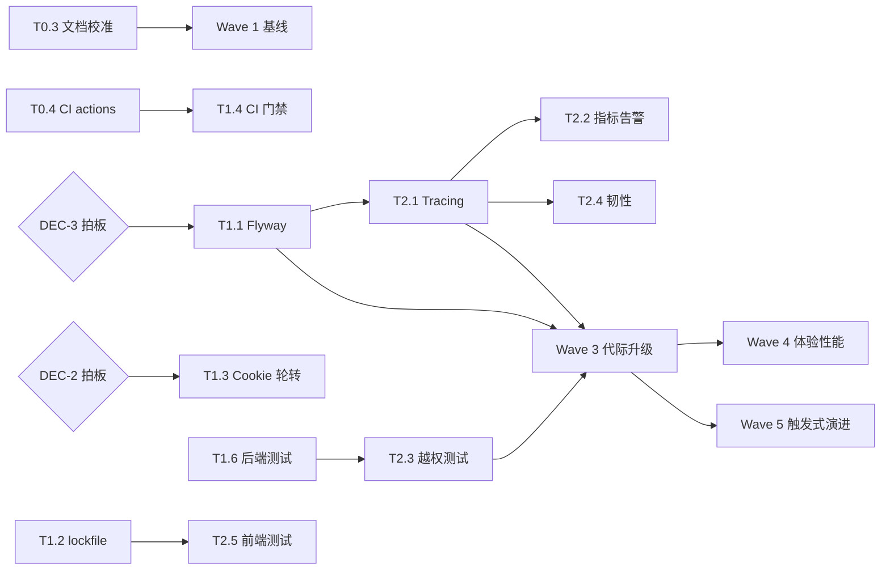

# baize 任务分解与执行计划（Roadmap → WBS）

> 本文是 [ROADMAP_2026.md](./ROADMAP_2026.md) 的**任务化落地清单**，把 Phase 0–5 拆成可直接派发的工作包（Work Package）。路线图回答"为什么做"，本文回答"具体做什么、按什么顺序、做到什么程度算完成"。
>
> 生成日期：2026-11-18。任务编号与路线图事项一一对应（T0.x ↔ Phase 0，以此类推）。
>
> **使用方式**：每个任务含「优先级 / 依赖 / 验收 / 拆解步骤 / 风险回退」。带 🔒 的任务被路线图决策点（DEC-1~7）阻塞，需先拍板；标注「可立即开工」的不依赖任何决策或运行态环境。

---

## 1. 任务总览

| 波次 | 对应 Phase | 任务数 | 性质 | 前置 | 建议窗口 |
|---|---|---:|---|---|---|
| Wave 0 | Phase 0 验收已交付 | 4 | 验证 + 文档校准 | 无（需运行环境）| 第 1–2 周 |
| Wave 1 | Phase 1 工程安全基线 | 6 | 地基，最高工程价值 | DEC-2/DEC-3（部分）| 第 1–2 月 |
| Wave 2 | Phase 2 可观测性韧性 | 5 | 稳定性 + 测试纵深 | Wave 1 部分 | 第 2–3 月 |
| Wave 3 | Phase 3 受控代际升级 | 5 | 框架升级 | DEC-1 + Wave 1/2 | 第 3–4 月 |
| Wave 4 | Phase 4 体验性能 | 5 | 前端体验 | Wave 3 可并行 | 第 4–5 月 |
| Wave 5 | Phase 5 触发式演进 | 9 | 条件触发 | 各任务触发条件 | 按需 |

**合计 34 个工作包**。其中「可立即开工」：T0.3、T0.4、T1.2、T1.5、T1.6（5 个）。

**最先该做的三件事**（无决策阻塞、见效快）：
1. **T0.3** 修 README:227 文档漂移（S，分钟级）
2. **T1.2** 提交 lockfile + CI 改 `npm ci`（S，可复现构建）
3. **T1.1** 引入 Flyway（L，地基中的地基，越早收益越大）

---

## 2. 决策门（先拍板再派发的任务）

| 决策 | 阻塞任务 | 需确认内容 | 未确认时的默认动作 |
|---|---|---|---|
| DEC-1 升级时机 | T3.1–T3.4 | 先补地基再升（推荐）还是立即升 | 默认按推荐：Wave 3 排在 Wave 1/2 之后 |
| DEC-2 token 存储 | T1.3 | 内存 access + HttpOnly refresh Cookie（推荐）vs 维持现状 | 默认不启动 T1.3，仅保留设计 |
| DEC-3 Flyway | T1.1 | 引入（推荐）vs 维持手工 | 默认不启动 T1.1；一旦确认即为最高优先 |
| DEC-4 部署收敛 | T5.2、T5.4 | 收敛单 Helm chart + GitOps | 默认留在 Wave 5 |
| DEC-5 pro-components | T3.3 后续 | 等官方 3.x stable（推荐）vs fork | 默认只升最新 beta，不 fork |
| DEC-6 僵尸表 | — | 已定 D3 保留不动 | 无任务 |
| DEC-7 架构演进 | T5.1、T5.5 等 | 触发式 | 默认不启动 |

> 建议：先一次性确认 **DEC-2、DEC-3** 两项（它们决定 Wave 1 的核心内容），其余可按路线图推荐值默认推进。

---

## 3. Wave 0 — Phase 0：验收已交付 + 文档校准

### T0.1 UI 端到端验证（P0 / M / 依赖：运行环境；🔒 需先重启后端 + 重建前端）
**目标**：把 2026-11 已合入但未端到端走通的功能一次性验收。

**拆解步骤**
1. 重启 `baize-system`（加载新实体/接口/字典种子），确认无启动异常。
2. 重建前端：本地先 `npm install`（package-lock.json 当前未入库），再 `npm run build` / `npm run dev`。
3. 逐项走查并记录证据（截图/接口日志）：
   - 租户内置禁删：内置租户/角色/字典删除按钮置灰，后端调用返回 `BUSINESS_CONFLICT`。
   - 字典驱动下拉：前端下拉选项来自 `sys_dict` 接口，非硬编码。
   - 公告展示：登录公告按租户/优先级正确显示，已读状态按 localStorage 记忆。
   - 岗位绑定：用户-岗位设置在 UI 可保存并可回读（user_post 新主键链路）。
   - 租户切换：UUIDv7 后切租户可用（P4 bug 已修，nil UUID 平台租户正确识别）。

**验收**：5 项全部走通 + 证据归档到 `docs/acceptance/2026-11.md`（新建）。
**风险回退**：任一项失败 → 在缺陷档案新增条目并回到对应提交排查，不进入 Wave 1 的"已交付"假设。

### T0.2 D4 编码复用 DML 实测（P1 / S / 依赖：专用或本地库）
**目标**：验证 partial unique index（`WHERE deleted='0'`）下逻辑删后编码可复用。
**步骤**：在专用/本地库插入一条测试记录 → 逻辑删（`deleted='1'`）→ 用同编码重新插入 → 断言成功。
**验收**：插入成功；若因 ON CONFLICT 仲裁失败，记录具体报错并评估是否需在对应唯一索引加 `WHERE deleted='0'`。**禁止在共享 dev 库做破坏性测试**。

### T0.3 修 README 文档漂移（P0 / S / 可立即开工）
**目标**：README:227 安全提醒第 4 条仍称"按用户查询权限码接口待实现"，实际多角色聚合（e5f673c）已实现。
**步骤**：改写该条为"权限码已烘焙进 token role claim（多角色聚合签发），后端按 claim 精确匹配"；补一句 `sys_perm/sys_role_perm` 按 D3 决策保留但签发不消费。
**验收**：README 描述与 `AuthServiceImpl` 签发逻辑一致；缺陷档案追加更正记录。

> ✅ 完成于 2026-11-18：README:227 改写为多角色聚合签发的实际逻辑（声明旧"接口待实现"作废），commit 18b522b。

### T0.4 CI actions 健康升级（P1 / S / 可立即开工）
**目标**：消除 ubuntu-latest 迁 Ubuntu 26 与 Node 运行时告警。
**步骤**：`checkout/setup-node/setup-java/setup-helm` 升 v5 或固定 SHA（与 T1.4 统一处理）；确认 Node20 仍装 setup-node 显式版本。
**验收**：四 job（backend/helm/frontend/sql）全绿，无 deprecation 告警。

> ✅ 完成于 2026-11-18：checkout/setup-java/setup-node/setup-helm 全部 → v5（均已发布稳定 major：checkout v5.0.0 / setup-node v5.0.0 / setup-java v5.4 / setup-helm v5.1.0），commit 4881d24。YAML 语法本地校验通过；CI 四 job 全绿需在 GitHub Actions 环境验证。

---

## 4. Wave 1 — Phase 1：工程与安全基线

### T1.1 引入 Flyway（P0 / L / 🔒 DEC-3 / 依赖：无）
**目标**：DEBT-1——把 16 个迁移纳入版本表，杜绝漏跑/重跑/顺序错。

**拆解步骤**
1. 依赖：`flyway-core` + `flyway-database-postgresql` 加入父 BOM，gateway/auth/system 按需引入（建议统一放到一个 schema 管理模块或各服务独立配置）。
2. 迁移位置决策：保留权威脚本在 `baize-backend/db/migration/`，Flyway 配置 `spring.flyway.locations=filesystem:db/migration`（本地/CI 同路径），或复制到 `src/main/resources/db/migration`（应用自管理，推荐二选一，避免双份）。
3. **存量库 vs 新库 baseline 策略（关键子任务）**：
   - 存量库：`baseline-on-migrate=true` + `baselineVersion=2026_11_07`（当前最新脚本版本），把已手工执行过的 16 个脚本标记为已应用，避免重复执行。
   - 新装库：仍走 `ddl → init → migration` 流程；init 已含种子，同样 baseline 到 `2026_11_07`，未来新脚本 `V2026_11_08+` 才由 Flyway 应用。
4. 约束：从此**禁止修改已应用的迁移**（forward-fix，新增脚本修正）。
5. CI：sql job 增加 `flyway_schema_history` 存在性断言 + 迁移后 schema 快照比对。

**验收**：`flyway_schema_history` 存在且版本连续；重复执行 0 变更；新库与存量库最终 schema 一致。
**风险回退**：baseline 前先 `pg_dump` 备份；保留手工执行路径作为回退。

### T1.2 提交 lockfile + CI 改 npm ci（P0 / S / 可立即开工）
**步骤**：从 `baize-ui/.gitignore` 移除 `package-lock.json` 忽略 → 生成并提交锁文件 → ci.yml frontend job 改 `npm ci` + `cache: npm`（cache-dependency-path 指向 lockfile）。
**验收**：冷环境两次 `npm ci` 产物一致；CI 构建通过且耗时不增。

> ✅ 完成于 2026-11-18：`.gitignore` 移除 `package-lock.json` 忽略并跟踪 1.2MB 锁文件；ci.yml frontend 改 `npm ci` + `cache: npm`（cache-dependency-path 指向锁文件）。`npm ci --dry-run` exit 0（lockfile 与 package.json 同步，removed 114 个残留包）；CI 构建通过需 GitHub Actions 环境验证。commit 待填。

### T1.3 token 存储改 HttpOnly Cookie + refresh 轮转（P0 / L / 🔒 DEC-2）
**目标**：DEBT-6——消除 XSS 单点窃取登录态。
**拆解步骤**
1. 后端 `AuthServiceImpl`：access token 15min 存前端内存；refresh token 长时随机串，只存哈希到 Redis，带轮转链（family id）；`/auth/refresh` 端点轮转并检测重用（复用即吊销整链）。
2. Set-Cookie：`HttpOnly; Secure; SameSite=Lax; Path=/api/auth`，CSRF 用 SameSite + 双重提交 Cookie。
3. 前端：移除 localStorage token；请求带 `credentials:'include'`；access 存模块内存，启动时用 refresh 静默恢复；401 → 刷新一次 → 重试。
4. 租户切换：重签 access+refresh 并清空内存。
5. 服务端校验租户成员关系后再签（不信任前端传参）。

**验收**：XSS 场景无法读取 refresh token；旧 refresh 复用触发整链吊销；登录/切租户/登出全链路正常。
**风险回退**：保留 feature flag，异常时切回原 localStorage 方案。

### T1.4 CI 安全门禁（P1 / M / 依赖：T0.4 协同）
**步骤**：`permissions: contents: read` 最小化；actions 固定 SHA；Renovate/Dependabot 配置；Trivy 镜像+依赖扫描（先告警后阻断）；CycloneDX Maven 插件产 SBOM；若上云改 OIDC 免密钥。
**验收**：每次 push/PR 产出 SBOM 与扫描报告；高危 CVE 阻断合并。

### T1.5 Biome 规则提升为 CI error（P1 / S / 可立即开工）
**步骤**：`biome ci` 接入 CI 并设为阻塞；保留 `tsc --noEmit`。
**验收**：lint/format 问题使 CI 变红；不影响 build job。

### T1.6 后端测试基线加固（P1 / M / 可立即开工）
**步骤**：修复 `SysNoticeServiceImplTest` 类 mock 失活（缺陷档案 :367–375）；surefire 保持在 3.2.5；新增"租户隔离/五档数据权限"优先测试用例的骨架。
**验收**：`mvn package` 单测全绿；核心鉴权模块有用例覆盖。

---

## 5. Wave 2 — Phase 2：可观测性与韧性

### T2.1 Micrometer Tracing + OTel → LGTM（P1 / L / 依赖：T1.1 可并行）
**步骤**：加 `micrometer-tracing-bridge-otel` + OTLP exporter；日志注入 `traceId` + `tenantId`；**验证 Gateway→Feign 的 W3C trace 透传**（Feign 拦截器）；采样先 10%。
**验收**：一次请求跨 gateway/auth/system 有同一 traceId；Grafana 可按 traceId 关联日志。

### T2.2 指标与告警（P1 / M / 依赖：T2.1）
**步骤**：`/actuator/prometheus` + Prometheus Operator ServiceMonitor；核心告警写 PrometheusRule 入 git。
**验收**：dashboard 可见 QPS/延迟/错误率；告警规则版本化。

### T2.3 租户越权自动化测试（P0 / M / 依赖：T1.6）
**步骤**：Testcontainers 起真实 PG/Redis；写"跨租户读隔离/数据权限越界"用例；契约测试覆盖 Gateway↔核心 Feign。
**验收**：越权用例在 CI 常驻并阻断（对齐 OWASP 2025 A01）。

### T2.4 韧性基础（P1 / M / 依赖：T2.1）
**步骤**：所有服务配 liveness/readiness/startupProbe + minReadySeconds；gateway/auth/system 副本≥2 + PDB(minAvailable=1) + 拓扑打散；统一 RestTemplate/WebClient 超时重试；Sentinel 规则经 Nacos 配置化。
**验收**：单实例驱逐不中断；限流规则热生效；探针全绿。

### T2.5 前端测试纵深（P1 / L / 依赖：T1.2）
**步骤**：Jest→Vitest + RTL（services/utils/access/关键 ProForm）；Playwright 少量高价值 E2E：登录→租户切换→RBAC 路由→核心 CRUD；加 `data-testid`。
**验收**：CI 分层测试跑通；核心链路 E2E 通过。

---

## 6. Wave 3 — Phase 3：受控框架代际升级

> 🔒 全部受 DEC-1 阻塞；**每步独立 commit、独立回归、可回退**。

### T3.1 JDK 17 → 21（P2 / M）
**验收**：全模块 `mvn package` 绿；无 `--add-opens` 回归。

### T3.2 Boot 3.2→3.5 / Cloud 2023→2025.0.0 / SCA 2023→2025.0.0.0（P2 / L）
**步骤**：一次性对齐三件套（**跳过 2024 线**）；Nacos 2.x→3.x breaking 单独验证配置迁移。
**验收**：四 job 全绿 + T0.1 的 5 项 UI 回归通过。依赖 T3.1。

### T3.3 pro-components 3.1.14-7 → 3.1.15-x 最新 beta（P1 / M / 🔒 DEC-5）
**步骤**：按 changelog/api-changes 扫破坏性变更；验证 `editableKeys`/`loadingRender`；升级后锁 lockfile。
**验收**：`tsc --noEmit` + UI 核心页回归。不承诺脱离 beta。

### T3.4 Nacos 版本统一（P1 / S）
**验收**：compose/k8s/helm 三处版本与数据源一致；配置拉取正常。

### T3.5 API 契约治理（P2 / M）
**步骤**：springdoc 产 OpenAPI 3.1；CI 校验 breaking change；对外 API 加 `/api/v1` 前缀（内部 Feign 保持 HTTP+JSON）。
**验收**：契约文档入库；breaking change 阻断。

---

## 7. Wave 4 — Phase 4：体验与性能

### T4.1 路由级 code splitting + 筛选入 URL（P2 / M）
**验收**：首屏 bundle 下降；筛选可分享/回退。依赖 T1.5/T2.5 基线。

### T4.2 大数据表格虚拟滚动（P2 / M）
**步骤**：antd Table `virtual` 或 pro-components 虚拟能力，先在日志页试点，注意与可编辑单元格兼容。
**验收**：万行级滚动流畅；分页正确。

### T4.3 React Compiler 灰度试点（P2 / M）
**步骤**：非核心页面开启，Profiler 对比级联重渲染，逐步移除手写 memo，**不一次性全量**。
**验收**：试点页重渲染下降且无回归。

### T4.4 TanStack Query 按需引入（P3 / M / 触发式）
**触发条件**：出现跨页共享服务端数据且需失效/去重时启动，集中 queryKey；否则维持现状。

### T4.5 主题/a11y 精修（P2 / S）
**验收**：键盘可达性检查通过；无 `.ant-*` 全局覆盖；暗色/紧凑走 ConfigProvider algorithm。

---

## 8. Wave 5 — Phase 5：触发式演进（启动前先写 ADR）

| 任务 | 优先级 | 触发条件 | 要点 |
|---|---|---|---|
| T5.1 PG RLS 纵深防御 | P3 | 高敏感租户数据/合规 | 保留 MP 插件为主，核心表叠加 RLS + 事务级 `SET LOCAL`，注意连接池串租户 |
| T5.2 Argo CD GitOps + Helm 收敛 | P2 | 多环境/多集群 | 三套部署件收敛单 Helm chart；compose 退守本地 |
| T5.3 SOPS/age 或 ESO 密钥管理 | P2 | 上生产且 Secret 需入库 | 杜绝明文 yaml；SOPS 与 Sealed Secrets 二选一 |
| T5.4 cosign 签名 + Kyverno 准入 | P3 | 供应链合规 | OIDC keyless 签名，Admission 强制已签名 |
| T5.5 读写分离/分库分表 | P3 | 单表千万级或写瓶颈实测 | 先 Spring 路由数据源，ShardingSphere-JDBC 最后手段 |
| T5.6 `sys_notice_read` 服务端已读表 | P3 | 需跨设备已读同步 | 替代 localStorage 记忆 |
| T5.7 operlog 覆盖 baize-gen | P3 | 需审计独立应用 | 切面仅覆盖本进程，baize-gen 需自身接入 |
| T5.8 utoopack 构建提速 | P3 | 构建耗时成瓶颈 | 优先 Umi 官方 utoopack，不自行换 bundler |
| T5.9 React 19.3 小版本升级 | P3 | 需 View Transitions 等 | 小版本跟进，风险低 |

---

## 9. 依赖图（关键路径）

**关键路径**：`DEC-3 → T1.1 Flyway → T2.1 Tracing → Wave 3 升级`。因此 **DEC-3 的拍板是整个roadmap 的关键路径起点**。

---

## 10. 完成定义（DoD）与执行纪律

- 每个任务必须有：独立 commit、验收证据（日志/截图/测试报告）、回退方案。
- 决策门未确认的任务不得擅自开工；默认动作见第 2 节。
- 升级类任务（Wave 3）每步回归 Phase 0 的 5 项 UI 清单。
- DB 变更走 expand→migrate→contract，禁止改已应用迁移。
- 关键决策（Flyway / token / Helm 收敛 / LGTM）在 `docs/adr/` 补 ADR 后再实施。
- 任务完成后在本文对应条目追加「✅ 完成于 <日期> / commit <hash>」，使本文成为滚动执行台账。

---

> 本文为执行计划，不含代码变更。开始执行前请确认第 2 节的 DEC-2、DEC-3，并告知从哪个 Wave 启动（推荐 Wave 0 → Wave 1）。
