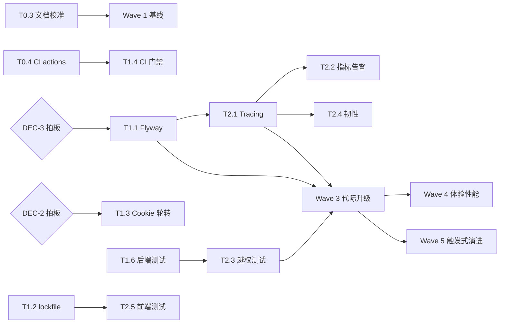

# baize 任务分解与执行计划（Roadmap → WBS）

> 本文是 [ROADMAP_2026.md](./ROADMAP_2026.md) 的**任务化落地清单**，把 Phase 0–5 拆成可直接派发的工作包（Work Package）。路线图回答"为什么做"，本文回答"具体做什么、按什么顺序、做到什么程度算完成"。
>
> 生成日期：2026-11-18。任务编号与路线图事项一一对应（T0.x ↔ Phase 0，以此类推）。
>
> **使用方式**：每个任务含「优先级 / 依赖 / 验收 / 拆解步骤 / 风险回退」。带 🔒 的任务被路线图决策点（DEC-1~7）阻塞，需先拍板；标注「可立即开工」的不依赖任何决策或运行态环境。

---

## 1. 任务总览

| 波次 | 对应 Phase | 任务数 | 性质 | 前置 | 建议窗口 |
|---|---|---:|---|---|---|
| Wave 0 | Phase 0 验收已交付 | 4 | 验证 + 文档校准 | 无（需运行环境）| 第 1–2 周 |
| Wave 1 | Phase 1 工程安全基线 | 6 | 地基，最高工程价值 | DEC-2/DEC-3（部分）| 第 1–2 月 |
| Wave 2 | Phase 2 可观测性韧性 | 5 | 稳定性 + 测试纵深 | Wave 1 部分 | 第 2–3 月 |
| Wave 3 | Phase 3 受控代际升级 | 5 | 框架升级 | DEC-1 + Wave 1/2 | 第 3–4 月 |
| Wave 4 | Phase 4 体验性能 | 5 | 前端体验 | Wave 3 可并行 | 第 4–5 月 |
| Wave 5 | Phase 5 触发式演进 | 9 | 条件触发 | 各任务触发条件 | 按需 |

**合计 34 个工作包**。其中「可立即开工」：T0.3、T0.4、T1.2、T1.5、T1.6（5 个）。

**最先该做的三件事**（无决策阻塞、见效快）：
1. **T0.3** 修 README:227 文档漂移（S，分钟级）
2. **T1.2** 提交 lockfile + CI 改 `npm ci`（S，可复现构建）
3. **T1.1** 引入 Flyway（L，地基中的地基，越早收益越大）

---

## 2. 决策门（先拍板再派发的任务）

| 决策 | 阻塞任务 | 需确认内容 | 未确认时的默认动作 |
|---|---|---|---|
| DEC-1 升级时机 | T3.1–T3.4 | 先补地基再升（推荐）还是立即升 | 默认按推荐：Wave 3 排在 Wave 1/2 之后 |
| DEC-2 token 存储 | T1.3 | 内存 access + HttpOnly refresh Cookie（推荐）vs 维持现状 | 默认不启动 T1.3，仅保留设计 |
| DEC-3 Flyway | T1.1 | 引入（推荐）vs 维持手工 | 默认不启动 T1.1；一旦确认即为最高优先 |
| DEC-4 部署收敛 | T5.2、T5.4 | 收敛单 Helm chart + GitOps | 默认留在 Wave 5 |
| DEC-5 pro-components | T3.3 后续 | 等官方 3.x stable（推荐）vs fork | 默认只升最新 beta，不 fork |
| DEC-6 僵尸表 | — | 已定 D3 保留不动 | 无任务 |
| DEC-7 架构演进 | T5.1、T5.5 等 | 触发式 | 默认不启动 |

> 建议：先一次性确认 **DEC-2、DEC-3** 两项（它们决定 Wave 1 的核心内容），其余可按路线图推荐值默认推进。

---

## 3. Wave 0 — Phase 0：验收已交付 + 文档校准

### T0.1 UI 端到端验证（P0 / M / 依赖：运行环境；🔒 需先重启后端 + 重建前端）
**目标**：把 2026-11 已合入但未端到端走通的功能一次性验收。

**拆解步骤**
1. 重启 `baize-system`（加载新实体/接口/字典种子），确认无启动异常。
2. 重建前端：本地先 `npm install`（package-lock.json 当前未入库），再 `npm run build` / `npm run dev`。
3. 逐项走查并记录证据（截图/接口日志）：
   - 租户内置禁删：内置租户/角色/字典删除按钮置灰，后端调用返回 `BUSINESS_CONFLICT`。
   - 字典驱动下拉：前端下拉选项来自 `sys_dict` 接口，非硬编码。
   - 公告展示：登录公告按租户/优先级正确显示，已读状态按 localStorage 记忆。
   - 岗位绑定：用户-岗位设置在 UI 可保存并可回读（user_post 新主键链路）。
   - 租户切换：UUIDv7 后切租户可用（P4 bug 已修，nil UUID 平台租户正确识别）。

**验收**：5 项全部走通 + 证据归档到 `docs/acceptance/2026-11.md`（新建）。
**风险回退**：任一项失败 → 在缺陷档案新增条目并回到对应提交排查，不进入 Wave 1 的"已交付"假设。

> ⏸ 2026-11-19 环境评估（部分交付，**BLOCKED**）：已新建 `docs/acceptance/2026-11.md` 归档环境评估结论与已完成证据。实测 Nacos 8848 / auth 8010 / 前端端口均未监听，无 Docker、无本地 Nacos、E2E 凭证未设置；远程 PG(192.168.5.4:30432)/Redis(30379) 可达但配置全在 Nacos，缺配置中心后端无法启动 → 5 项 UI 走查无法执行。已完成本地可验证部分：`cd baize-ui && npm run build` 成功（全部页面产出）。待用户补齐可用 Nacos + 后端服务栈与测试账号后执行 5 项走查。

> ✅ 2026-11-19 完成（commit ef9e947；用户提供远程 Nacos `192.168.5.4:30848` namespace `baize` 后）：三服务（auth 8010 / gateway 8000 / system 8020）+ 前端 3000 全部启动，5 项走查在活服务栈执行完毕，证据归档 `docs/acceptance/2026-11.md`。结果：①租户内置禁删 PASS ②字典驱动下拉 PASS ③公告链路通/无种子数据 ④岗位链路通/无种子数据（sys_post 全库 0 行，未做写库回读避免污染共享库）⑤租户切换 PASS（JWT X-Tenant-Id 正确重签）。走查中发现并修复**登录日志 msg 溢出缺陷**（`AuthController` 空体登录把完整 Feign 异常 message ~400 字符写入 `sys_login_log.msg` varchar(255) 报错）→ 新增 `LOG_MSG_MAX_LENGTH=255` + `truncate()`；重打包后重放空体登录回归：`value too long` 0 次、DB `msg_len=255` 落库成功。另排除"用户不存在"假阳性（GET /user/list 误命中 /{id}，真实分页是 POST /user/page）。遗留运维同步项：Nacos 上 `baize-system-dev.yml` 缺 Flyway 配置块（已用 JVM 属性覆盖启动）、网关 CORS 缺 `X-XSRF-TOKEN`（T1.3 flag 默认关暂不影响）。

### T0.2 D4 编码复用 DML 实测（P1 / S / 依赖：专用或本地库）
**目标**：验证 partial unique index（`WHERE deleted='0'`）下逻辑删后编码可复用。
**步骤**：在专用/本地库插入一条测试记录 → 逻辑删（`deleted='1'`）→ 用同编码重新插入 → 断言成功。
**验收**：插入成功；若因 ON CONFLICT 仲裁失败，记录具体报错并评估是否需在对应唯一索引加 `WHERE deleted='0'`。**禁止在共享 dev 库做破坏性测试**。

### T0.3 修 README 文档漂移（P0 / S / 可立即开工）
**目标**：README:227 安全提醒第 4 条仍称"按用户查询权限码接口待实现"，实际多角色聚合（e5f673c）已实现。
**步骤**：改写该条为"权限码已烘焙进 token role claim（多角色聚合签发），后端按 claim 精确匹配"；补一句 `sys_perm/sys_role_perm` 按 D3 决策保留但签发不消费。
**验收**：README 描述与 `AuthServiceImpl` 签发逻辑一致；缺陷档案追加更正记录。

> ✅ 完成于 2026-11-18：README:227 改写为多角色聚合签发的实际逻辑（声明旧"接口待实现"作废），commit 18b522b。

### T0.4 CI actions 健康升级（P1 / S / 可立即开工）
**目标**：消除 ubuntu-latest 迁 Ubuntu 26 与 Node 运行时告警。
**步骤**：`checkout/setup-node/setup-java/setup-helm` 升 v5 或固定 SHA（与 T1.4 统一处理）；确认 Node20 仍装 setup-node 显式版本。
**验收**：四 job（backend/helm/frontend/sql）全绿，无 deprecation 告警。

> ✅ 完成于 2026-11-18：checkout/setup-java/setup-node/setup-helm 全部 → v5（均已发布稳定 major：checkout v5.0.0 / setup-node v5.0.0 / setup-java v5.4 / setup-helm v5.1.0），commit 4881d24。YAML 语法本地校验通过；CI 四 job 全绿需在 GitHub Actions 环境验证。

---

## 4. Wave 1 — Phase 1：工程与安全基线

### T1.1 引入 Flyway（P0 / L / 🔒 DEC-3 / 依赖：无）
**目标**：DEBT-1——把 16 个迁移纳入版本表，杜绝漏跑/重跑/顺序错。

**拆解步骤**
1. 依赖：`flyway-core` + `flyway-database-postgresql` 加入父 BOM，gateway/auth/system 按需引入（建议统一放到一个 schema 管理模块或各服务独立配置）。
2. 迁移位置决策：保留权威脚本在 `baize-backend/db/migration/`，Flyway 配置 `spring.flyway.locations=filesystem:db/migration`（本地/CI 同路径），或复制到 `src/main/resources/db/migration`（应用自管理，推荐二选一，避免双份）。
3. **存量库 vs 新库 baseline 策略（关键子任务）**：
   - 存量库：`baseline-on-migrate=true` + `baselineVersion=2026_11_07`（当前最新脚本版本），把已手工执行过的 16 个脚本标记为已应用，避免重复执行。
   - 新装库：仍走 `ddl → init → migration` 流程；init 已含种子，同样 baseline 到 `2026_11_07`，未来新脚本 `V2026_11_08+` 才由 Flyway 应用。
4. 约束：从此**禁止修改已应用的迁移**（forward-fix，新增脚本修正）。
5. CI：sql job 增加 `flyway_schema_history` 存在性断言 + 迁移后 schema 快照比对。

**验收**：`flyway_schema_history` 存在且版本连续；重复执行 0 变更；新库与存量库最终 schema 一致。
**风险回退**：baseline 前先 `pg_dump` 备份；保留手工执行路径作为回退。

> ✅ 完成于 2026-11-19（DEC-3 已拍板=引入）：`baize-parent` 加 `flyway.version=9.22.3`/`postgresql.driver.version=42.7.7` 及 dependencyManagement；`baize-system` 引入 `flyway-core`+`postgresql` 驱动，配 `spring.flyway.*` **专用数据源**（url/user/password/driver-class-name 走 `${baize.datasource.master.*}`，绕过 dynamic-datasource 路由层），`baseline-on-migrate=true`+`baseline-version=2026_11_07`+`validate-on-migrate=true`。构建期 `maven-resources-plugin` 把权威脚本单向复制到 `target/classes/db/migration`（`locations=classpath:db/migration`），fat jar 自包含 16 脚本+flyway-core+PG 驱动，K8s 无需挂载 db 目录——ADR-0001 决策 2 已同步改为 classpath 单源。**修复阻塞级问题**：16 个迁移中 `V2026_10_23` 重复（home_menu 与 platform_tenant_0 同版本，Flyway duplicate version 直接拒启），`git mv` platform_tenant_0 → `V2026_10_23_02`，同步 `DEFECTS_AND_ROADMAP.md:78` 引用；16 个版本现全唯一。CI sql job 新增：重复版本号断言 + `flyway-maven-plugin:9.22.3:migrate`（独立 POM `db/flyway-validate-pom.xml`，PG 驱动作插件依赖）+ `flyway_schema_history` 存在/非空/无失败断言。验证：parent install exit 0；baize-system `package` BUILD SUCCESS；scratch 库手工 ddl→init→migration 后 Flyway validate 16/16 成功、baseline 2026_11.07 建立；YAML_OK；CI 断言 SQL 实测 ASSERT_OK。commit f3d4e00。

### T1.2 提交 lockfile + CI 改 npm ci（P0 / S / 可立即开工）
**步骤**：从 `baize-ui/.gitignore` 移除 `package-lock.json` 忽略 → 生成并提交锁文件 → ci.yml frontend job 改 `npm ci` + `cache: npm`（cache-dependency-path 指向 lockfile）。
**验收**：冷环境两次 `npm ci` 产物一致；CI 构建通过且耗时不增。

> ✅ 完成于 2026-11-18：`.gitignore` 移除 `package-lock.json` 忽略并跟踪 1.2MB 锁文件；ci.yml frontend 改 `npm ci` + `cache: npm`（cache-dependency-path 指向锁文件）。`npm ci --dry-run` exit 0（lockfile 与 package.json 同步，removed 114 个残留包）；CI 构建通过需 GitHub Actions 环境验证。commit 83898ed。

### T1.3 token 存储改 HttpOnly Cookie + refresh 轮转（P0 / L / 🔒 DEC-2）
**目标**：DEBT-6——消除 XSS 单点窃取登录态。
**拆解步骤**
1. 后端 `AuthServiceImpl`：access token 15min 存前端内存；refresh token 长时随机串，只存哈希到 Redis，带轮转链（family id）；`/auth/refresh` 端点轮转并检测重用（复用即吊销整链）。
2. Set-Cookie：`HttpOnly; Secure; SameSite=Lax; Path=/api/auth`，CSRF 用 SameSite + 双重提交 Cookie。
3. 前端：移除 localStorage token；请求带 `credentials:'include'`；access 存模块内存，启动时用 refresh 静默恢复；401 → 刷新一次 → 重试。
4. 租户切换：重签 access+refresh 并清空内存。
5. 服务端校验租户成员关系后再签（不信任前端传参）。

**验收**：XSS 场景无法读取 refresh token；旧 refresh 复用触发整链吊销；登录/切租户/登出全链路正常。
**风险回退**：保留 feature flag，异常时切回原 localStorage 方案。

> ✅ 完成于 2026-11-19（commit 37c9309）：按 m05398 拍板策略「后端完整能力 + flag 默认关」实施，前端零改动、现网零影响。
> - **能力**：refresh 明文只经 HttpOnly Cookie 下发（`AuthCookieHelper` 写 refresh HttpOnly + CSRF 非 HttpOnly 双 Cookie，Path=/api/v1/auth，SameSite=Lax，secure 由配置控制）；服务端 `RefreshTokenStore` 只存 SHA-256(Base64url) 哈希为 key、`RefreshTokenRecord.encode()` 为 value，TTL 7 天；family 轮转链（issue/issueForFamily）+ used 标记 + 复用检测（used 令牌再出现即 `revokeFamily` 整族吊销）；CSRF 双重提交（头值==Cookie 值）；`refreshToken()` 校验令牌内 tenant/user 与 DTO 一致防跨租户重放；登出按 refresh 吊销整族并清 Cookie。
> - **flag 分支**：`AuthCookieProperties.enabled`（默认 false）——关时 `issueTokenForUser`/`refreshToken`/`logout` 完全走原 UUID 明文 + `TokenManager` 链路，JSON 仍返回 refresh，前端 localStorage/Bearer 行为不变；开时 JSON 剔除 refresh（`@JsonIgnore` IssuedRefresh 仅 service→controller 内部传递，`loginVO.refreshToken=null`）。
> - **配置**：`baize-auth-dev.yml` 加 `baize.security.token-cookie` 块（默认关）；`baize-gateway-dev.yml` CORS allowedHeaders 加 `X-XSRF-TOKEN`。灰度切换前提：前端配合 `credentials:'include'` + 携带 CSRF 头。
> - **测试**：`RefreshTokenRecordTest`（3：编解码往返/用户名含 '|' 保留末字段/畸形返回 null）+ `RefreshTokenStoreTest`（4：只存哈希/consume 标记 used/复用吊销整族/轮转同 family），baize-auth 测试栈换 `spring-boot-starter-test`；`mvn -pl baize-auth -am test` 7 用例全绿（含 JwtUtilsTest 4）。
> - **未做（下一步灰度）**：前端切 Cookie 模式（移除 localStorage、credentials/include、401 静默刷新）、access 缩到 15min — 留作后续工作包；BFF 演进记入 ADR-0002。

### T1.4 CI 安全门禁（P1 / M / 依赖：T0.4 协同）
**步骤**：`permissions: contents: read` 最小化；actions 固定 SHA；Renovate/Dependabot 配置；Trivy 镜像+依赖扫描（先告警后阻断）；CycloneDX Maven 插件产 SBOM；若上云改 OIDC 免密钥。
**验收**：每次 push/PR 产出 SBOM 与扫描报告；高危 CVE 阻断合并。

> ✅ 完成于 2026-11-19：ci.yml 顶部加 `permissions: contents: read` 全局最小权限（OIDC 提权留作未来上云时局部开启）。6 类 action（checkout/setup-java/setup-node/setup-helm/upload-artifact/trivy-action）全部通过 GitHub API 实测 tag→commit SHA 并固定到 SHA + 注释版本号，共 12 处，防 tag 漂移/供应链投毒（azure/setup-helm v5 SHA commit 未签名，已记录）。新增 `security` job：CycloneDX `makeAggregateBom` 2.9.1 产出聚合 SBOM（JSON/XML，实测 295 组件）经 upload-artifact v7 上传；Trivy fs 扫描（CRITICAL/HIGH、ignore-unfixed）先以 `continue-on-error` 告警运行，基线清理后去该行即转阻断。新建 `.github/dependabot.yml` 覆盖 github-actions + 两处 maven（baize-parent/baize-backend）+ npm（baize-ui），每周一自动提更新 PR。本地验证：js-yaml 校验 ci.yml/dependabot.yml YAML_OK；cyclonedx 目标 BOM 生成 BUILD SUCCESS。OIDC 未启用（当前非上云部署）。commit 34902b8。

### T1.5 Biome 规则提升为 CI error（P1 / S / 可立即开工）
**步骤**：`biome ci` 接入 CI 并设为阻塞；保留 `tsc --noEmit`。
**验收**：lint/format 问题使 CI 变红；不影响 build job。

> ✅ 完成于 2026-11-18：`npx biome check --write .` 修复 77 个文件的格式/import 顺序（纯格式化，tsc --noEmit exit 0 无语义变更）；`biome.json` includes 排除 Umi 自动生成目录 `!**/.umi-undefined`（7 个残留 lint error 全在该目录）；`npx biome ci .` exit 0（27 warnings，0 errors）。ci.yml frontend 在 Build 前新增 `Biome CI (lint + format)` 阻塞步骤。commit 578e010。

### T1.6 后端测试基线加固（P1 / M / 可立即开工）
**步骤**：修复 `SysNoticeServiceImplTest` 类 mock 失活（缺陷档案 :367–375）；surefire 保持在 3.2.5；新增"租户隔离/五档数据权限"优先测试用例的骨架。
**验收**：`mvn package` 单测全绿；核心鉴权模块有用例覆盖。

> ✅ 完成于 2026-11-18：`SysNoticeServiceImplTest` mock 失活修复已在 HEAD（f982b04，4/4 通过，无需重复改）；surefire 保持 3.2.5。新增 `baize-common-database` 测试依赖（spring-boot-starter/test），落地两个测试骨架共 12 用例：`CustomTenantHandlerTest`（4：上下文缺失兜底 nil UUID / 精确下推 / 切租户 / sys_tenant 豁免）、`CustomDataScopeHandlerTest`（8：档 1~5 全档位 + 空集合 1=0 + 注入串拒绝 + skip 标记）。**顺带修复 UUIDv7 迁移回归**：`CustomDataScopeHandler` 的 `NUMERIC`（`\d{1,19}`）替换为 `SAFE_ID`（历史纯数字 ≤19 位 或 标准 UUID 8-4-4-4-12），否则 dept_id/create_by 改为 varchar(36) UUID 后档 2/3/4/5 全退化为 `1=0`（该拦截器当前 `enabled()` 默认 false，属潜伏缺陷非现网故障）。`mvn -pl baize-common/baize-common-database -am test` → Tests run: 12, Failures: 0, Errors: 0, BUILD SUCCESS。commit 0f36087。

---

## 5. Wave 2 — Phase 2：可观测性与韧性

### T2.1 Micrometer Tracing + OTel → LGTM（P1 / L / 依赖：T1.1 可并行）
**步骤**：加 `micrometer-tracing-bridge-otel` + OTLP exporter；日志注入 `traceId` + `tenantId`；**验证 Gateway→Feign 的 W3C trace 透传**（Feign 拦截器）；采样先 10%。
**验收**：一次请求跨 gateway/auth/system 有同一 traceId；Grafana 可按 traceId 关联日志。

> ✅ 完成于 2026-11-19：**从 SkyWalking 完整迁移到 OpenTelemetry**（决策见 `docs/adr/0003-observability-otel-lgtm.md`）。父 POM 删除 `skywalking.version=9.4.0` 与 `apm-toolkit-trace` depMgmt；gateway/auth/system/example/gen 五模块加 `micrometer-tracing-bridge-otel` + `opentelemetry-exporter-otlp` + `micrometer-registry-prometheus`（版本全部由 Boot 3.2.12 BOM 管理：micrometer-tracing 1.2.12 / otel 1.31.0 / micrometer 1.12.13，**不要显式写版本，也不要在 depMgmt 里重复声明**——BOM 不回填会报 version missing）。`TraceFilter` 改用 `io.opentelemetry.api.trace.Span.current().getSpanContext()`，traceId 优先级＝上游 `X-Trace-Id` → OTel 有效非全零 → UUID 兜底，同时写 `traceId`/`spanId` 两个 MDC key。**修真实缺陷**：`HeaderInterceptor` 原只写 ThreadLocal `RequestContextHolder.setTraceId()` 不写 MDC，导致下游服务日志 traceId 恒空、无法与网关串联；改为仅在 MDC 无 traceId 时兜底写入（不覆盖 OTel 权威值）+ `afterCompletion` 清理防线程复用污染。`application-dev.yml` 加 `management` 块（endpoints 暴露、probes、metrics 公共 tag、histogram、sampling 1.0、W3C 传播、OTLP endpoint）。**实测证据**（本机 system 8020）：日志出现真实 `[baize-system,...,9e83b681dca8ff379c4299ed1511c874,24c5e33af8630aba]`（迁移前恒空）；`/api/v1/actuator/prometheus` 200 返回 220 行指标含 `application="baize-system"` 与 `http_server_requests_seconds_bucket`；liveness/readiness 均 200；`mvn test` 30 用例全绿。注意 actuator 在 context-path 下**必须带 `/api/v1` 前缀**。commit f8bf53e。

### T2.2 指标与告警（P1 / M / 依赖：T2.1）
**步骤**：`/actuator/prometheus` + Prometheus Operator ServiceMonitor；核心告警写 PrometheusRule 入 git。
**验收**：dashboard 可见 QPS/延迟/错误率；告警规则版本化。

> ✅ 完成于 2026-11-19：新增 `deploy/k8s/13-servicemonitor.yaml`（`monitoring.coreos.com/v1` ServiceMonitor，按 `app.kubernetes.io/part-of: baize` + `baize.io/metrics: "true"` 选取，path `/api/v1/actuator/prometheus`、interval 30s、relabelings 补 pod/service 标签；文件末尾注释给出无 Operator 时裸 Prometheus `scrape_config` 替代方案）与 `deploy/k8s/14-prometheusrule.yaml`（4 组 8 条告警：可用性 `BaizeServiceDown`/`BaizeReadinessFailing`、错误率 `BaizeHighErrorRate` 5xx>5%/`BaizeHigh4xxRate`、延迟 `BaizeHighLatencyP99`>2s、资源 `BaizeJvmHeapHigh`>90%/`BaizeContainerOOMKilled`/`BaizeDbPoolExhausted`），全部规则入库版本化、走 `SKIP_MONITORING=1` 可跳过。新增 `deploy/observability/` 5 文件（docker-compose.observability.yml + otel-collector-config.yaml + tempo-config.yaml + prometheus.yml + grafana-datasources.yaml + README.md），Grafana 三条数据源（Prometheus exemplar→Tempo、Loki derivedFields 按 `"traceId":"([0-9a-f]{32})"` 抽 traceId、Tempo tracesToLogsV2/tracesToMetrics）互相打通。**顺带修复真实缺陷**：`GlobalExceptionHandler` 原把未映射路径（含已收敛的 actuator 端点）落进 `Exception` 兜底返回 500「系统内部错误」，会让客户端 404 污染 5xx 错误率指标并误触发 `BaizeHighErrorRate` 告警；新增 `handleNotFoundPath` 处理 Boot 3 `NoResourceFoundException` + Boot 2 `NoHandlerFoundException` 返回 404 + 新错误码 `RESOURCE_NOT_FOUND(40004)`。**实测**：`/api/v1/actuator/{env,heapdump,threaddump,beans,configprops,sentinel}` 全部由 500 变 **404 + errorCode 40004**；Prometheus 指标中 404 归类为 `outcome="CLIENT_ERROR"` 而非 5xx。静态校验：python yaml.safe_load_all 遍历 13 个 YAML 全 OK。commit 7388f79。

### T2.3 租户越权自动化测试（P0 / M / 依赖：T1.6）
**步骤**：Testcontainers 起真实 PG/Redis；写"跨租户读隔离/数据权限越界"用例；契约测试覆盖 Gateway↔核心 Feign。
**验收**：越权用例在 CI 常驻并阻断（对齐 OWASP 2025 A01）。

> ⏸ 本轮跳过（用户 2026-11-19 决策）：本机无 `docker`/`helm`/`kubectl`，Testcontainers 无法本地验证，避免交付未经实跑验证的测试骨架。租户隔离与五档数据权限的**单元级**覆盖已由 T1.6 的 `CustomTenantHandlerTest`(4) + `CustomDataScopeHandlerTest`(8) 提供；真实容器级越权用例留待具备 Docker 环境时补。

### T2.4 韧性基础（P1 / M / 依赖：T2.1）
**步骤**：所有服务配 liveness/readiness/startupProbe + minReadySeconds；gateway/auth/system 副本≥2 + PDB(minAvailable=1) + 拓扑打散；统一 RestTemplate/WebClient 超时重试；Sentinel 规则经 Nacos 配置化。
**验收**：单实例驱逐不中断；限流规则热生效；探针全绿。

> ✅ 完成于 2026-11-19：新增 `deploy/k8s/10-app-deployments.yaml`（gateway/auth/system 三 Deployment，各 replicas=2、RollingUpdate maxUnavailable=0、terminationGracePeriodSeconds=45、runAsNonRoot/runAsUser 1000、`-XX:MaxRAMPercentage=75 -XX:+UseG1GC`、startup/liveness/readiness 三探针全部指向 `/api/v1/actuator/health/{liveness,readiness}`、preStop sleep 5、topologySpreadConstraints 按 hostname+zone 打散、prometheus.io 注解）、`11-app-pdb.yaml`（3× PDB minAvailable=1）、`12-app-services.yaml`（3× ClusterIP + `baize.io/metrics` 标签供 ServiceMonitor 选取）。`deploy.sh` 由 4 步扩为 5 步：中间件就绪 `kubectl wait` → apply 应用层 → 监控件受 `SKIP_MONITORING=1` 控制且 CRD 缺失时降级为警告不中断。配置层：`application-dev.yml` 加 `spring.lifecycle.timeout-per-shutdown-phase: 30s` + `server.shutdown: graceful`（Boot 3 默认 immediate）+ `feign.client.config.default` 超时基线 5s/10s（项目无 RestTemplate/WebClient，Feign 是唯一出站通道；**故意不开启 retryer**——写操作重试会放大重复提交）。`baize-auth-dev.yml` 把 `management.endpoints.web.exposure.include` 由 `'*'` 收敛为 `health,info,prometheus,metrics`（原值会把 env/heapdump/threaddump 暴露在网关可达路径下）。**Sentinel 规则经 Nacos 配置化**：三模块 POM 显式加 `com.alibaba.csp:sentinel-datasource-nacos`（SCA 把它声明为 `optional=true` 不传递引入，必须显式声明，版本由 SCA BOM 管 1.8.8）；gateway/auth/system 三个 `-dev.yml` 各加 `spring.cloud.sentinel.datasource.*.nacos` 块；规则文件入库 `doc/DEFAULT_GROUP/sentinel/{baize-gateway-gw-flow,baize-auth-flow,baize-system-flow}.json` 并已发布到 Nacos。**🔴 关键坑（已修）**：`application-dev.yml` 原 `spring.cloud.sentinel.enabled: false`（注释"开发集群未部署控制台直接关闭"）会导致 `SentinelAutoConfiguration` 整类不装配 → `SentinelDataSourceHandler` 不注册 → **Nacos 数据源永远不加载、规则恒空**，极易被误判为"规则没生效"；改为 `enabled: true` + `transport.dashboard:` 留空（SCA 约定地址为空则不尝试连接 dashboard）。**实测证据**：`curl localhost:8719/getRules?type=flow` 返回 2 条规则（`/api/v1/system/dict/data/all` 100、`/api/v1/system/user/getByUsername` 200，与 Nacos 内容一致）；200 并发突发请求实测 **100×200 + 100×429**，限流真实生效；三探针端点均 200；`server.shutdown=graceful` 已注入。commit 7388f79。

### T2.5 前端测试纵深（P1 / L / 依赖：T1.2）
**步骤**：Jest→Vitest + RTL（services/utils/access/关键 ProForm）；Playwright 少量高价值 E2E：登录→租户切换→RBAC 路由→核心 CRUD；加 `data-testid`。
**验收**：CI 分层测试跑通；核心链路 E2E 通过。

> ✅ **已完成**（2026-11-19，commit 8e13688）Jest→Vitest 迁移：`vitest@2.1.9`+`jsdom@25.0.1`+RTL；删除失效的 jest.config.ts（`@umijs/max/test` 子路径在已装版本不存在，基线 `npm test` 直接报错）与 tests/setupTests.jsx（旧 antd v5 路径 `antd/lib/theme/internal`）；新建 vitest.config.ts（@/@@ 别名、jsdom、matchMedia polyfill）+ tests/vitest.setup.ts + 4 个单测文件共 26 用例（permission 9 / pagination 7 / tree 4 / auth 6，auth 用 TextEncoder→latin1 构造无签名 JWT 绕开 btoa 中文报错）。package.json 脚本改 test=vitest run / test:coverage / test:watch / test:update，新增 test:e2e。验证：`npm run test` 26/26、`npm run tsc` 0、`npx biome ci .` 0 error（33 warning 基线保留）。CI frontend job 在 Biome 与 Build 之间加阻塞步骤 `npm run test`。Playwright 骨架：playwright.config.ts（E2E_BASE_URL 可配、单 worker、trace on-first-retry）+ e2e/auth.spec.ts（登录重定向/字段渲染/有效凭证登录）+ e2e/tenant.spec.ts（租户切换弹窗），凭证缺失自动 skip，不进 CI 裸跑；登录页与 TenantSwitcher 补 `data-testid`。E2E 真实执行需要有后端栈的环境，未在本机跑（仅骨架 + tsc 校验）。回退：保留单测为门禁，E2E 维持 advisory。

---

## 6. Wave 3 — Phase 3：受控框架代际升级

> 🔒 全部受 DEC-1 阻塞；**每步独立 commit、独立回归、可回退**。

### T3.1 JDK 17 → 21（P2 / M）
**验收**：全模块 `mvn package` 绿；无 `--add-opens` 回归。

### T3.2 Boot 3.2→3.5 / Cloud 2023→2025.0.0 / SCA 2023→2025.0.0.0（P2 / L）
**步骤**：一次性对齐三件套（**跳过 2024 线**）；Nacos 2.x→3.x breaking 单独验证配置迁移。
**验收**：四 job 全绿 + T0.1 的 5 项 UI 回归通过。依赖 T3.1。

### T3.3 pro-components 3.1.14-7 → 3.1.15-x 最新 beta（P1 / M / 🔒 DEC-5）
**步骤**：按 changelog/api-changes 扫破坏性变更；验证 `editableKeys`/`loadingRender`；升级后锁 lockfile。
**验收**：`tsc --noEmit` + UI 核心页回归。不承诺脱离 beta。

### T3.4 Nacos 版本统一（P1 / S）
**验收**：compose/k8s/helm 三处版本与数据源一致；配置拉取正常。

### T3.5 API 契约治理（P2 / M）
**步骤**：springdoc 产 OpenAPI 3.1；CI 校验 breaking change；对外 API 加 `/api/v1` 前缀（内部 Feign 保持 HTTP+JSON）。
**验收**：契约文档入库；breaking change 阻断。

---

## 7. Wave 4 — Phase 4：体验与性能

### T4.1 路由级 code splitting + 筛选入 URL（P2 / M）
**验收**：首屏 bundle 下降；筛选可分享/回退。依赖 T1.5/T2.5 基线。

### T4.2 大数据表格虚拟滚动（P2 / M）
**步骤**：antd Table `virtual` 或 pro-components 虚拟能力，先在日志页试点，注意与可编辑单元格兼容。
**验收**：万行级滚动流畅；分页正确。

### T4.3 React Compiler 灰度试点（P2 / M）
**步骤**：非核心页面开启，Profiler 对比级联重渲染，逐步移除手写 memo，**不一次性全量**。
**验收**：试点页重渲染下降且无回归。

### T4.4 TanStack Query 按需引入（P3 / M / 触发式）
**触发条件**：出现跨页共享服务端数据且需失效/去重时启动，集中 queryKey；否则维持现状。

### T4.5 主题/a11y 精修（P2 / S）
**验收**：键盘可达性检查通过；无 `.ant-*` 全局覆盖；暗色/紧凑走 ConfigProvider algorithm。

---

## 8. Wave 5 — Phase 5：触发式演进（启动前先写 ADR）

| 任务 | 优先级 | 触发条件 | 要点 |
|---|---|---|---|
| T5.1 PG RLS 纵深防御 | P3 | 高敏感租户数据/合规 | 保留 MP 插件为主，核心表叠加 RLS + 事务级 `SET LOCAL`，注意连接池串租户 |
| T5.2 Argo CD GitOps + Helm 收敛 | P2 | 多环境/多集群 | 三套部署件收敛单 Helm chart；compose 退守本地 |
| T5.3 SOPS/age 或 ESO 密钥管理 | P2 | 上生产且 Secret 需入库 | 杜绝明文 yaml；SOPS 与 Sealed Secrets 二选一 |
| T5.4 cosign 签名 + Kyverno 准入 | P3 | 供应链合规 | OIDC keyless 签名，Admission 强制已签名 |
| T5.5 读写分离/分库分表 | P3 | 单表千万级或写瓶颈实测 | 先 Spring 路由数据源，ShardingSphere-JDBC 最后手段 |
| T5.6 `sys_notice_read` 服务端已读表 | P3 | 需跨设备已读同步 | 替代 localStorage 记忆 |
| T5.7 operlog 覆盖 baize-gen | P3 | 需审计独立应用 | 切面仅覆盖本进程，baize-gen 需自身接入 |
| T5.8 utoopack 构建提速 | P3 | 构建耗时成瓶颈 | 优先 Umi 官方 utoopack，不自行换 bundler |
| T5.9 React 19.3 小版本升级 | P3 | 需 View Transitions 等 | 小版本跟进，风险低 |

---

## 9. 依赖图（关键路径）

**关键路径**：`DEC-3 → T1.1 Flyway → T2.1 Tracing → Wave 3 升级`。因此 **DEC-3 的拍板是整个roadmap 的关键路径起点**。

---

## 10. 完成定义（DoD）与执行纪律

- 每个任务必须有：独立 commit、验收证据（日志/截图/测试报告）、回退方案。
- 决策门未确认的任务不得擅自开工；默认动作见第 2 节。
- 升级类任务（Wave 3）每步回归 Phase 0 的 5 项 UI 清单。
- DB 变更走 expand→migrate→contract，禁止改已应用迁移。
- 关键决策（Flyway / token / Helm 收敛 / LGTM）在 `docs/adr/` 补 ADR 后再实施。
- 任务完成后在本文对应条目追加「✅ 完成于 <日期> / commit <hash>」，使本文成为滚动执行台账。

---

> 本文为执行计划，不含代码变更。开始执行前请确认第 2 节的 DEC-2、DEC-3，并告知从哪个 Wave 启动（推荐 Wave 0 → Wave 1）。
